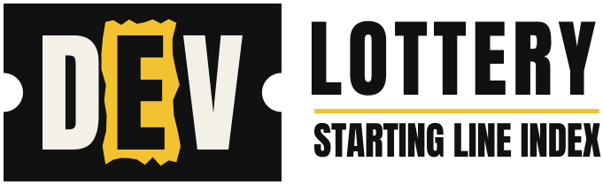

<p align="center"></p>

# DEV Lottery

**Same hustle. Different spawn point.**

DEV Lottery measures how unequal the starting line is for software developers and indie hackers, country by country — built in one zero-dependency HTML file (`EN / AR`).

- **Birth Lottery**: spin to respawn using real UN birth odds, scratch your ticket, or click **Spin until «Easy»** to challenge friends.
- **"Start From Zero" Simulator**: test the classic 4-step indie hacker playbook from your passport vs. the Netherlands — paying an `$80/mo` AI stack, connecting Stripe, flying to Bali, and attending a San Francisco tech conference — then export a **Split VS Card PNG** for X.
- **Starting Line Index**: compare any 2 of **33 countries** (covering ~56% of world births), filter by difficulty (`Easy`, `Normal`, `Hard`, `Nightmare`), and switch between Cards and Table views.

> Not affiliated with the U.S. Diversity Visa (DV) program. This site offers no visa services.

## The score (0–100)

| Indicator | Weight | What it measures | Source |
| --- | --- | --- | --- |
| EARN | 40% | Can you receive money from abroad? `100` = Direct Stripe, `75` = Restricted/local partner (Paystack, Invite-only Preview), `60` = PayPal receives, `30` = Paddle only, `0` = Sanctioned / none | stripe.com/global, Paddle countries, PayPal docs |
| BUY | 40% | Work hours for a `$20/month` tool (and `$80/month` AI stack in the simulator), at **market** FX where parallel rates exist, log-scaled between fixed goalposts (`0.38h` best, `71h` worst) | World Bank GNI per capita ÷ 12, market FX |
| MOVE | 20% | Visa-free destinations (`23–192` scale) + Bali entry rules & US ESTA eligibility | Henley Passport Index 2026 |

Tiers: **Easy** (`75+`), **Normal** (`50–74`), **Hard** (`25–49`), **Nightmare** (`0–24`).  
Draw weights: annual live births 2024, UN World Population Prospects 2024.

## Features (v2)

- Bilingual **English / Arabic** (`EN / AR`) with auto-detection and `?lang=en|ar` deep links
- **Start From Zero Simulator** with 4 interactive steps & **Split VS Card PNG** export (`1200×675`)
- **33 countries** including major global indie hacker hubs (Brazil, Indonesia, Philippines, Turkey, Poland, Ukraine, Mexico, Kenya, UAE, Saudi Arabia, Lebanon, plus original 22)
- Shareable comparison URLs (`?a=DZA&b=NLD`) and challenge URLs (`#challenge-ISO-N`)
- Optional zero-dependency global draw counter in `counter/`

## Run it

One static file, no build step, no dependencies.

```bash
open index.html            # or: python3 -m http.server 8000
```

Deploy anywhere that serves static files (GitHub Pages, Coolify, Nginx).

## Global draw counter (optional)

`counter/` is a tiny Node server (no dependencies) that counts draws across all visitors.

1. Deploy `/counter` (Dockerfile included) with a persistent volume at `/data` and `ALLOWED_ORIGIN` set to your site URL.
2. Put the counter's public URL in `COUNTER_API` inside `index.html`. Leave it empty to hide the counter.
